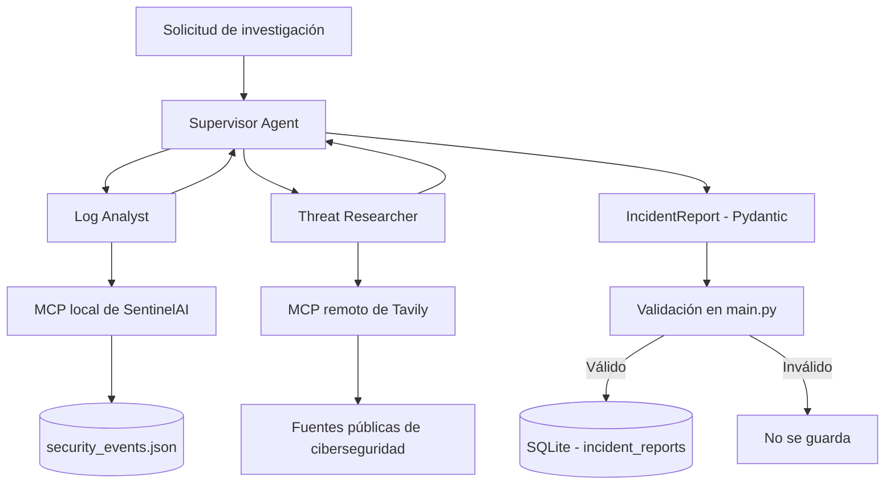
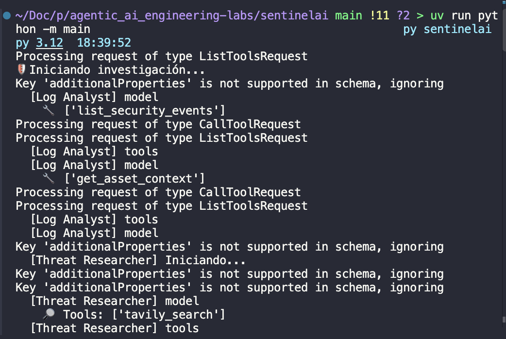
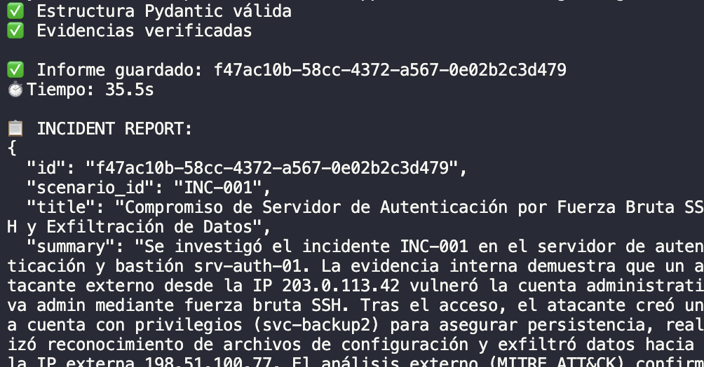
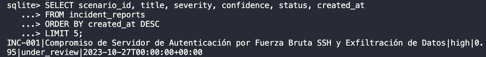

# SentinelAI 🛡️

**Laboratorio de ingeniería de IA agéntica para investigar incidentes de ciberseguridad con LangChain, LangGraph y Model Context Protocol (MCP).**

SentinelAI utiliza agentes especializados para analizar **registros de seguridad sintéticos**, investigar técnicas y amenazas mediante fuentes públicas y producir un `IncidentReport` estructurado. La aplicación valida las referencias del informe y lo guarda en **SQLite**.

> **Proyecto educativo, no un SIEM ni un sistema de respuesta a incidentes listo para producción.** Todos los eventos son ficticios. Las direcciones IP de ejemplo pertenecen a rangos reservados para documentación. Las conclusiones deben revisarse antes de tomar decisiones reales.

## Arquitectura y funcionamiento

1. El **Supervisor Agent** recibe una solicitud para investigar un escenario.
2. Delega el análisis de eventos internos al **Log Analyst**, que consulta el MCP local de SentinelAI.
3. Cuando es útil, solicita investigación externa al **Threat Researcher**, conectado al MCP de Tavily.
4. Consolida los hallazgos en un **`IncidentReport` de Pydantic**.
5. `main.py` comprueba el esquema y que los `event_id` y activos referenciados existan en el dataset.
6. Si las validaciones se cumplen, `IncidentRepository` persiste el reporte en **SQLite**.



| Componente                            | Responsabilidad                                                                           |
| ------------------------------------- | ----------------------------------------------------------------------------------------- |
| `agents/supervisor.py`                | Coordinar especialistas y producir el informe estructurado                                |
| `agents/log_analyst.py`               | Analizar eventos, consultar activos y citar evidencias internas                           |
| `agents/threat_researcher.py`         | Investigar técnicas y documentación pública con Tavily                                    |
| `mcp_server/server.py`                | Exponer `list_security_events`, `get_event_details`, `search_events`, `get_asset_context` |
| `mcp_client.py`                       | Conectar ambos servidores mediante `MultiServerMCPClient`                                 |
| `models/incident.py`                  | Definir el esquema Pydantic de `IncidentReport`                                           |
| `repositories/incident_repository.py` | Persistir y recuperar informes en SQLite                                                  |
| `main.py`                             | Inicializar dependencias, ejecutar la investigación, validar y guardar                    |

El servidor MCP local utiliza **stdio**: el cliente lo inicia como subproceso, sin necesidad de levantar un servidor HTTP adicional. Tavily se conecta mediante **streamable HTTP**.

## Stack tecnológico

- **Python 3.12** y [uv](https://docs.astral.sh/uv/)
- **LangChain + LangGraph** para agentes, orquestación y delegación
- **Google Gemini** mediante `langchain-google-genai`
- **MCP Python SDK** (`mcp`) y `langchain-mcp-adapters`
- **Tavily MCP** para investigación en internet
- **Pydantic + Pydantic Settings** para contratos y configuración
- **SQLite** (`sqlite3`) para persistencia local
- **LangSmith** para trazas y observabilidad opcional

## Estructura del mini-proyecto

SentinelAI es una carpeta independiente dentro del repositorio de laboratorios:

```text
agentic_ai_engineering-labs/
└── sentinelai/
    ├── main.py
    ├── pyproject.toml
    ├── uv.lock
    ├── .env.example
    ├── data/
    │   ├── security_events.json
    │   └── sentinelai.sqlite3    # Se genera localmente
    ├── src/sentinelai/
    │   ├── agents/
    │   │   ├── log_analyst.py
    │   │   ├── threat_researcher.py
    │   │   └── supervisor.py
    │   ├── config/settings.py
    │   ├── mcp_server/server.py
    │   ├── models/incident.py
    │   ├── repositories/incident_repository.py
    │   ├── tools/delegation.py
    │   └── mcp_client.py
    ├── tests/
```

## Instalación y ejecución

### 1. Requisitos

- Python **3.12**
- [`uv`](https://docs.astral.sh/uv/getting-started/installation/)
- API key de **Google AI Studio** (Gemini)
- API key de **Tavily** para la investigación externa
- API key de **LangSmith** únicamente si deseas habilitar trazas

### 2. Clonar e instalar dependencias

Reemplaza el marcador por la URL real de tu repositorio:

```bash
git clone <URL_DE_TU_REPOSITORIO>
cd agentic_ai_engineering-labs/sentinelai
uv sync
```

`uv sync` crea o sincroniza el entorno, instala las dependencias y registra el paquete local bajo `src/sentinelai/`. El archivo `uv.lock` debe mantenerse versionado.

### 3. Configurar las variables de entorno

Crea o conserva este archivo **`.env.example`** en `sentinelai/`:

```dotenv
# Google Gemini
GOOGLE_API_KEY=
GEMINI_MODEL=gemini-2.5-flash

# Tavily MCP
TAVILY_API_KEY=
TAVILY_MCP_URL=https://mcp.tavily.com/mcp/

# LangSmith (opcional)
LANGSMITH_TRACING=false
LANGSMITH_API_KEY=
LANGSMITH_PROJECT=sentinelai
```

Crea tu archivo privado `.env`:

```bash
cp .env.example .env
```

Completa las claves en `.env`:

| Variable            | ¿Dónde obtenerla?                                                                    | Uso                                              |
| ------------------- | ------------------------------------------------------------------------------------ | ------------------------------------------------ |
| `GOOGLE_API_KEY`    | [Google AI Studio — API keys](https://aistudio.google.com/apikey)                    | Autenticar llamadas al modelo Gemini             |
| `GEMINI_MODEL`      | Consultar [modelos Gemini disponibles](https://ai.google.dev/gemini-api/docs/models) | Elegir un modelo disponible en tu proyecto/cuota |
| `TAVILY_API_KEY`    | Crear cuenta y obtener clave en [Tavily](https://app.tavily.com/)                    | Acceder a herramientas de investigación web      |
| `TAVILY_MCP_URL`    | Endpoint MCP de Tavily; el valor de ejemplo suele ser suficiente                     | Conexión remota MCP                              |
| `LANGSMITH_API_KEY` | Crear clave en [LangSmith](https://smith.langchain.com/)                             | Trazabilidad de ejecuciones, opcional            |
| `LANGSMITH_TRACING` | `true` para habilitar trazas o `false` para deshabilitarlas                          | Observabilidad                                   |
| `LANGSMITH_PROJECT` | Nombre que quieras darle al proyecto, p. ej. `sentinelai`                            | Agrupación de trazas                             |

La configuración se centraliza en `sentinelai.config.settings` mediante **Pydantic Settings**. `main.py` pasa la clave de Gemini explícitamente al modelo. Si tu versión actual de `Settings` requiere otras variables, inclúyelas también en `.env.example`.

**Seguridad:** nunca subas `.env`, API keys ni `data/sentinelai.sqlite3` a GitHub. Inclúyelos en `.gitignore`.

### 4. Ejecutar una investigación

Desde `agentic_ai_engineering-labs/sentinelai/`:

```bash
uv run python -m main
```

En la versión actual, modifica la variable `scenario_id` o el texto de investigación dentro de `main.py` para elegir entre `INC-001`, `INC-002` o `INC-003`.

La aplicación construye los agentes y herramientas MCP, ejecuta el Supervisor, recupera `structured_response`, valida las referencias a eventos y activos y, si el informe es válido, lo guarda en SQLite.

**Salida orientativa** (no es una captura real ni garantiza que Gemini haga siempre las mismas llamadas):

```text
Log Tools: ['list_security_events', 'get_event_details', 'search_events', 'get_asset_context']
Research Tools: ['tavily_search', 'tavily_extract', ...]
[...s] model
Tools: ['ask_log_analyst']
  [Log Analyst] ...
[...s] model
Tools: ['ask_threat_researcher']
  [Threat Researcher] ...
✅ Estructura Pydantic válida
✅ Evidencias verificadas
✅ Informe guardado: <report_id>
```

La duración y las llamadas pueden variar según el modelo y el estado de los servicios. Tavily tiene límites/cuotas de uso. Si hay un error del proveedor (p. ej., `504`), revisa la traza y vuelve a intentar; **nunca persistas un informe inválido o incompleto**.

### 5. Consultar los informes en SQLite

SQLite es una base de datos embebida: **no requiere levantar ningún servicio**. El repositorio crea o abre el archivo local.

```bash
sqlite3 data/sentinelai.sqlite3
```

Dentro de la consola SQLite:

```sql
.tables
SELECT scenario_id, title, severity, confidence, status, created_at
FROM incident_reports
ORDER BY created_at DESC
LIMIT 5;
.quit
```

También puedes consultar el reporte completo utilizando `IncidentRepository.get(report_id)` o el campo JSON persistido, según la implementación actual del repositorio.

### 6. Ejecutar las pruebas

```bash
uv run pytest -v
```

Las pruebas que utilicen Tavily o Gemini requieren acceso a internet, claves válidas y cuota disponible. Conviene mantener las pruebas unitarias separadas de las integraciones externas.

## Dataset de laboratorio

El archivo [`data/security_events.json`](data/security_events.json) incluye **45 eventos ficticios** y **3 activos** distribuidos en estos escenarios:

| Escenario | Eventos | Descripción                                                                            | Resultado esperado del análisis                                                                         |
| --------- | ------: | -------------------------------------------------------------------------------------- | ------------------------------------------------------------------------------------------------------- |
| `INC-001` |      20 | Fallos SSH, acceso administrativo exitoso, cambios de privilegios y tráfico sospechoso | Reconocer actividad de alto riesgo, citar eventos y evitar afirmar exfiltración sin pruebas suficientes |
| `INC-002` |      13 | Despliegue autorizado en ventana de mantenimiento, con ticket `CHG-2041`               | Reconocer el contexto legítimo y evitar falsos positivos                                                |
| `INC-003` |      12 | Telemetría incompleta y contexto insuficiente del activo                               | Declarar la investigación inconclusa y solicitar más evidencias                                         |

**Importante:** el JSON también contiene etiquetas de evaluación en `scenarios`. Son para comparar resultados durante pruebas, **no constituyen evidencia**. Las tools del MCP local deben exponer los eventos y activos, no las respuestas esperadas.

## Evidencias del laboratorio — capturas de pantalla

Añade tus imágenes en `docs/screenshots/` utilizando los nombres indicados. Los enlaces siguientes se mostrarán automáticamente en GitHub cuando estén los archivos.

### Captura 1 — Orquestación multiagente en consola

Muestra la llamada del Supervisor a `ask_log_analyst`, las llamadas a `list_security_events` y `get_asset_context`, la delegación a `ask_threat_researcher` y el tiempo de ejecución.



### Captura 2 — Generación, validación y guardado del informe

Muestra el resultado `IncidentReport` y los mensajes de confirmación de la validación Pydantic, comprobación de `event_id` y persistencia exitosa.



### Captura 3 — Evidencia de persistencia en SQLite

Muestra el resultado de la consulta SQL sobre `incident_reports`, con escenario, severidad, estado, fecha e identificador del reporte (si está disponible en tu consulta).



**Consejo:** si tu captura de terminal contiene toda la ejecución en una imagen demasiado larga, usa dos recortes de la misma ejecución: uno para delegación y llamadas a herramientas, y otro para validación y guardado. Evita que el texto quede ilegible al verlo en GitHub.

## Limitaciones y uso responsable

- Trabaja únicamente con **datos simulados**; no reemplaza un SIEM ni un analista de seguridad.
- El LLM puede formular hipótesis incorrectas o mostrar una confianza excesiva.
- Verificar que los `event_id` existan **no demuestra** que respalden todas las conclusiones.
- MITRE ATT&CK contextualiza técnicas, pero no demuestra que un incidente específico haya ocurrido.
- SentinelAI **no ejecuta acciones de contención**: no bloquea IPs ni modifica servidores.
- Se recomienda **revisión humana** antes de utilizar los resultados para tomar decisiones.

## Próximas mejoras

- Evaluación automatizada de los tres escenarios con métricas reproducibles.
- Revisión de procedencia y relevancia de fuentes externas.
- Manejo robusto de fallos parciales y tiempos de espera de proveedores.
- Salidas estructuradas de especialistas y métricas de latencia/costo en LangSmith.

---

_Proyecto de aprendizaje de Agentic AI Engineering: MCP, delegación multiagente, salidas estructuradas, validación y persistencia._
